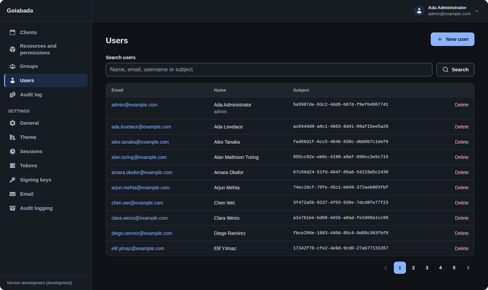
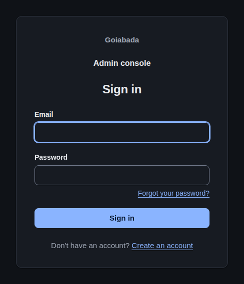

<p align="center">
  
</p>

<h1 align="center">Goiabada</h1>

<p align="center"><strong>Self-hosted sign-in, single sign-on, and permissions for your apps.</strong></p>

<p align="center">
  <a href="https://github.com/leodip/goiabada/releases/latest"></a>
  <a href="https://github.com/leodip/goiabada/actions/workflows/check.yml"></a>
  <a href="LICENSE"></a>
  <a href="https://awesome-go.com/"></a>
</p>

<p align="center">
  <a href="https://goiabada.dev/get-started/quickstart/"><strong>Try it locally</strong></a> ·
  <a href="https://goiabada.dev/guides/add-sign-in-to-a-web-app/"><strong>Add sign-in to a web app</strong></a> ·
  <a href="https://goiabada.dev/"><strong>Explore the docs</strong></a>
</p>

<p align="center">
  
</p>

Goiabada is an open-source authentication server built on **OAuth 2.0** and **OpenID Connect**. Your apps sign users in with any standard OAuth 2.0 or OpenID Connect library, with no SDK to adopt, and you choose where the auth server and its database run.

## What you get



- **One account across your apps.** Single sign-on, authorization code flow with PKCE, and optional two-factor authentication with step-up for sensitive apps.
- **Control over access.** Give users, groups, and clients permissions; include groups and custom attributes in tokens when your apps need them.
- **An admin console and API.** Manage users, clients, settings, and signing keys through the web UI or automate them through the API. Review changes in the audit log.
- **Account self-service.** Users can manage their profile and security settings, recover a password, and review their sessions. You can enable self-registration and email verification.
- **Your name, your users' language.** The pages come in English, Portuguese (Brazil), Spanish, French, German, and Italian, in light and dark themes. Put your app's name on them, give each client its own logo, and reword any text.
- **A choice of deployment.** The setup wizard prepares Docker Compose, Kubernetes, or native binary deployments. Use SQLite, PostgreSQL, MySQL, or SQL Server. Docker images support x86_64 and ARM64, and both servers can expose Prometheus metrics.

## Standards

- **OAuth 2.0** (RFC 6749): authorization code with PKCE (RFC 7636), client credentials, and refresh tokens.
- **Token revocation** (RFC 7009): an app ends a grant, typically at sign-out, by sending its refresh token or an access token.
- **Token introspection** (RFC 7662): an API asks whether a token is still active, for the resources an administrator allowed it.
- **OpenID Connect**: Core 1.0 with ID tokens and userinfo, Discovery 1.0, and RP-Initiated Logout 1.0.
- **Metadata and keys**: authorization server metadata (RFC 8414) and a JWKS endpoint (RFC 7517).
- **Access tokens**: JWT access tokens (RFC 9068), which an API checks on its own with the auth server's public keys.
- **[Dynamic client registration](https://goiabada.dev/guides/let-clients-register-themselves-dcr/)** (RFC 7591), for apps such as MCP clients.
- **Legacy flows**: the implicit and password grants, off by default.

## Privacy

Goiabada runs on your servers, and your users' data stays in your database. It doesn't phone home: there's no telemetry, and its pages load no fonts, scripts, or images from anyone else's servers. The one exception is the optional [Turnstile challenge](https://goiabada.dev/guides/require-a-turnstile-challenge/): while you have it on, the sign-in, forgot-password and registration forms load Cloudflare's widget, and the auth server asks Cloudflare to verify each submission.

## Security

An auth server holds the keys to everything else, so security comes first in every change. Among what Goiabada does:

- **Passwords** are hashed with bcrypt and follow NIST SP 800-63B by default, refusing commonly used ones. Password and one-time code guessing is rate limited per account.
- **Tokens**: PKCE is required for every public client, and a refresh token works once, so a replayed one revokes its whole family.
- **Revocation that holds**: changing a password, disabling a user or ending a session revokes the sessions and refresh tokens it authorized, an app revoking its token ends that one grant and leaves the user signed in, and the auth server refuses their access tokens at once.
- **Secrets encrypted at rest** with AES-256-GCM, and sessions kept on the server behind an `HttpOnly`, `SameSite` cookie, with CSRF protection on every form.
- **Minimal container images**, with no package manager, running as a non-root user, and rescanned for vulnerabilities every week.
- **Every change checked** by static analysis (`gosec`, `govulncheck`), the race detector, and tests on all four databases.

See [Security](https://goiabada.dev/reference/security/) for the full list. Found a vulnerability? Email [contact@leodip.com](mailto:contact@leodip.com), and keep it private until a fix is released.

## Get started

All you need is Docker with Docker Compose. In an empty directory, download the [setup wizard](https://goiabada.dev/deploy/setup-wizard/) for your platform, run it for local testing with SQLite, and start Goiabada.

**Linux and macOS**: set `PLATFORM` to `linux-amd64`, `linux-arm64`, `darwin-arm64` (Apple Silicon), or `darwin-amd64` (Intel).

```bash
PLATFORM=linux-amd64
curl -LO https://github.com/leodip/goiabada/releases/latest/download/goiabada-setup-$PLATFORM
chmod +x goiabada-setup-$PLATFORM
./goiabada-setup-$PLATFORM --type=local --db=sqlite
docker compose up -d
grep GOIABADA_ADMIN_PASSWORD docker-compose.override.yml
```

**Windows** (PowerShell):

```powershell
curl.exe -LO https://github.com/leodip/goiabada/releases/latest/download/goiabada-setup-windows-amd64.exe
.\goiabada-setup-windows-amd64.exe --type=local --db=sqlite
docker compose up -d
Select-String GOIABADA_ADMIN_PASSWORD docker-compose.override.yml
```

Open the admin console at `http://localhost:9091` and sign in as `admin@example.com` with the password the last command prints. The [quickstart](https://goiabada.dev/get-started/quickstart/) walks through each step. When you're ready to run it for others, [choose a deployment method](https://goiabada.dev/deploy/choose-a-method/).

[Documentation](https://goiabada.dev/) · [Contributing](https://goiabada.dev/about/contributing/) · [Issues](https://github.com/leodip/goiabada/issues) · [MIT license](LICENSE)
